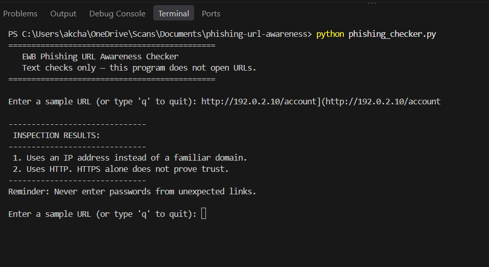
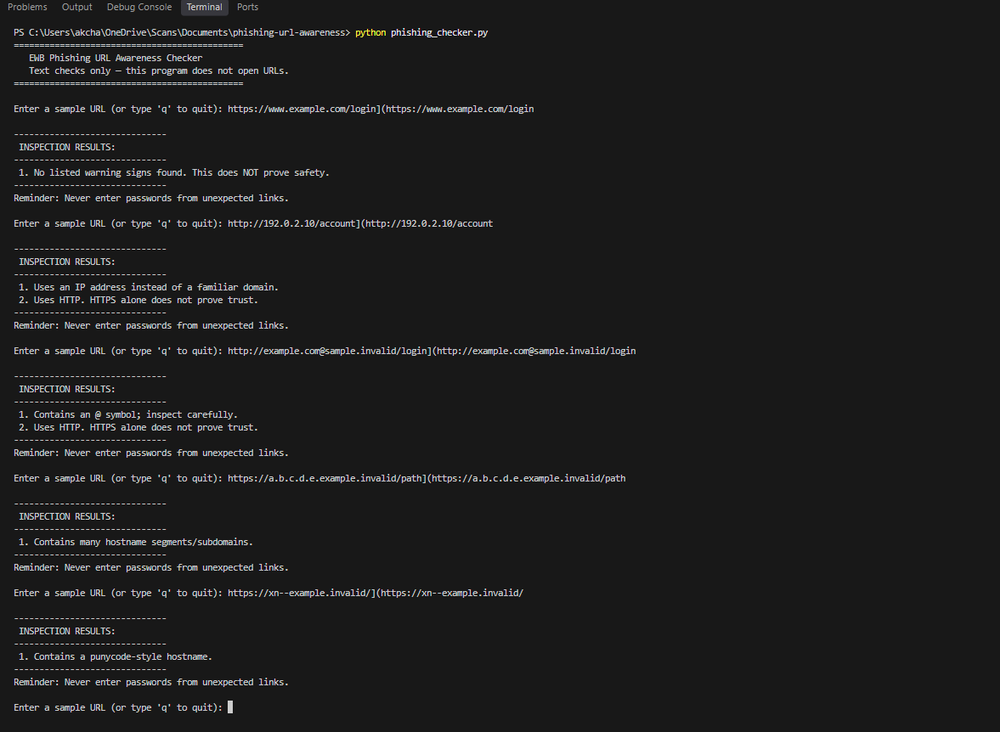

# EWB Phishing URL Awareness Checker

## Overview
Phishing is a form of social engineering where attackers use deceptive links to trick individuals into revealing sensitive credentials or personal data. This tool is a lightweight, educational Python script that scans text-based URL strings for common phishing indicators without visiting or executing the links.

## Features
- Detects an @ symbol in the URL
- Flags unusually long URLs (over 100 characters)
- Flags IP-address hostnames
- Flags many hostname segments (5 or more)
- Flags punycode-style hostnames (xn--)
- Flags the HTTP scheme
- [Option A] Continuous input loop with a quit command
- [Option E] Enhanced visual formatting and numbered output lists

## Requirements
Python 3.10 or later. No extra packages.

## How to Run
Windows: `python phishing_checker.py`
Mac/Linux: `python3 phishing_checker.py`

## Example Output
```text
=============================================
   EWB Phishing URL Awareness Checker
   Text checks only — this program does not open URLs.
=============================================

Enter a sample URL (or type 'q' to quit): [http://192.0.2.10/account](http://192.0.2.10/account)

------------------------------
 INSPECTION RESULTS:
------------------------------
 1. Uses an IP address instead of a familiar domain.
 2. Uses HTTP. HTTPS alone does not prove trust.
------------------------------
Reminder: Never enter passwords from unexpected links.
```
## Testing
| # | Input | Expected | Actual | Result |
|---|---|---|---|---|
| 1 | `https://www.example.com/login` | No warning signs | No warning signs found | [PASS] |
| 2 | `http://192.0.2.10/account` | IP warning | IP warning found | [PASS] |
| 3 | `http://example.com@sample.invalid/login` | @ symbol warning | @ symbol warning found | [PASS] |
| 4 | `https://a.b.c.d.e.example.invalid/path` | Subdomain warning | Subdomain warning found | [PASS] |
| 5 | `https://xn--example.invalid/` | Punycode warning | Punycode warning found | [PASS] |
## Screenshots



## Improvements
1. **Option A (Continuous Loop):** Added a `while True` loop so the program stays open for multiple checks and safely terminates when the user types `q`, `quit`, or `exit`. Checked by testing continuous inputs and typing `q` to exit.
2. **Option E (Enhanced Output Formatting):** Added clean visual title headers, dashed borders (`---`), and numbered lists to organize output findings clearly. Checked by verifying terminal output structures.
## Limitations
This is an educational tool. It only reads URL text. It does not visit URLs, scan for malware or prove that a URL is safe. No warning signs found does NOT mean a URL is safe

## Ethical Use
Use sample strings only. Do not collect credentials. Do not use this project to deceive anyone or to test websites without permission.

## Author
akchansh, Cybersecurity, EWB Courses